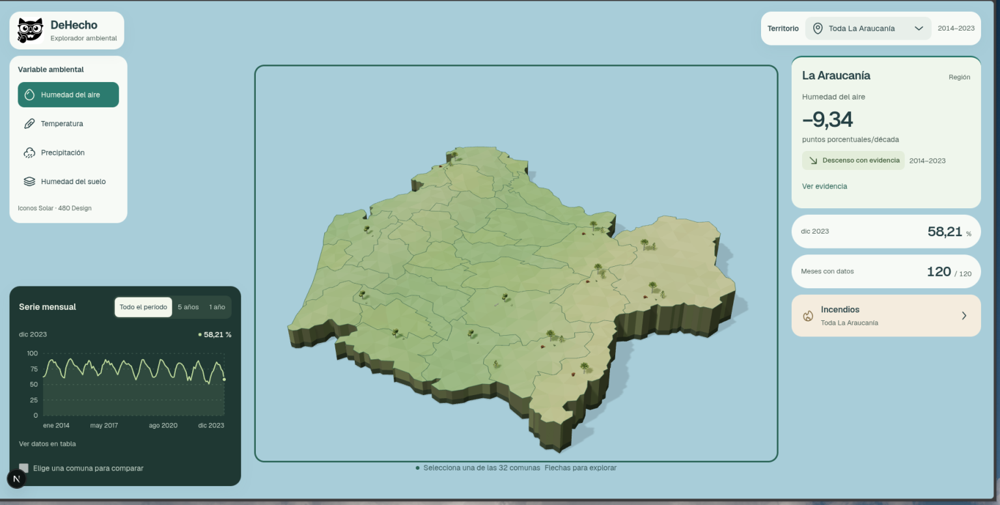

# DeHecho

**A statistical explorer of environmental change and wildfire associations in La Araucanía, Chile.**



*Interface preview. The frontend is maintained in a separate repository: [low-poly-studio](https://github.com/maiki-22/low-poly-studio).*

## Project overview

DeHecho helps users examine **how environmental conditions change, where those changes occur, how large they are, and what statistical evidence supports them**. It also examines their associations with wildfires recorded by Chile's National Forestry Corporation (CONAF).

Developed for the [NASA Space Apps 2026 Earth System Trend Detective challenge](https://www.spaceappschallenge.org/2026/challenges/earth-system-trend-detective/?tab=details), the project turns existing environmental data and statistical analyses into a read-only evidence explorer. **It is not a forecasting, risk prediction, or alert system.**

This repository contains the analysis and FastAPI backend. The separate frontend presents the territory through a low-poly interface using Blockbench assets; its API integration is outside the scope of this backend implementation. See the [architecture](ARQUITECTURA.md) and [project brief](PROYECTO.md) for further details.

### What can be explored

- Regional and municipal time series of temperature, precipitation, relative humidity, and soil moisture.
- Monthly anomalies: departures from typical conditions for the same calendar month within the reference period, documented in the analysis outputs.
- Environmental trends for 2014–2023, with magnitude, uncertainty, and statistical evidence.
- Four adjusted regional wildfire associations from the existing negative binomial model, together with summaries of its findings and sensitivity.
- Fourteen exploratory regional trends and five environmental summaries, preserving a separate Holm multiple-testing correction.

The analyses are available in `analisis.ipynb`, with outputs in `datos_mensuales_2014_2023/limpios/` and exploratory research in `docs/investigacion/`. The API serves the existing series, trends, adjusted associations, and summaries; correlations and group comparisons are not yet exposed. Analyses only need to be rerun when the underlying data or analysis changes, never for individual requests.

### Main findings

- **Relative humidity declines with statistical evidence** at regional and municipal scales during 2014–2023 in the original four-variable analysis. The other three variables do not meet the evidence threshold after correction; this does not demonstrate an absence of change.
- The regional exploration identifies increasing area-mean monthly temperature peaks and declining dew point and specific humidity. These signals share underlying information and are not independent confirmations. Vapor pressure deficit (VPD) proxies are not true mean VPD; these results establish neither new wildfire associations nor differences between trend slopes, and cannot be extrapolated to municipalities.
- **Rainfall deficit has the most stable adjusted association with wildfire counts across the model variants examined.** This is not necessarily the variable changing most strongly, nor a validated predictor.

### Data coverage and interpretation

- **Environmental coverage:** 120 months from January 2014 to December 2023, covering 32 municipalities. The joint regional wildfire analysis uses 114 matched months, July 2014–December 2023.
- **Wildfire coverage:** regional monthly counts and municipal counts by July–June fire season. There are no fire coordinates or municipal monthly breakdowns; regional totals must not be distributed across municipalities.
- **Regional alignment:** `definitivo.csv` aligns the same 114 matched months by calendar `fecha`; `año_x` retains the fire-season starting year. It does not replace the 120-month environmental baseline used for trends.
- **Quality:** Saavedra's soil moisture is excluded because of low coverage, while its other variables are retained. Unknown coverage is not equivalent to 100%; missing values are not zeros. Municipalities may share source pixels and are not independent replicates.
- **Interpretation:** the negative binomial model and its associations are explanatory, not evidence of causality or predictions of risk. Fire counts do not measure burned area or severity. Regional associations must not be interpreted as municipal effects.

## Use of SI

OpenAI Codex and GPT models were used to automate most of the code generation for the API and preliminary dataset analysis. AI assistance does not independently validate scientific findings or replace review and testing. Responsibility for methodological choices, validation, and interpretation remains with the project team.

## Run locally

From the project root, use Python 3.12 or later. The reference environment uses Python 3.14.10 on Linux. Create the virtual environment only if it does not already exist:

```sh
python3 -m venv .venv
```

Install or update the API, analysis, and test dependencies from the single requirements file:

```sh
.venv/bin/python -m pip install -r requirements.txt
.venv/bin/python -m pip check
```

`requirements.txt` also retains additional packages used by the working environment. Do not replace it with `pip freeze` without reviewing the change: that command reflects only what is installed in the selected interpreter, not the requirements of the whole project.

Start the service:

```sh
.venv/bin/python -m uvicorn main:app --reload
```

Open **http://127.0.0.1:8000/docs**. No publication artifacts or environment-variable configuration are required. The legacy `DEHECHO_MANIFEST` variable is no longer used.

## Available datasets

At startup, the API reads the environmental CSV and JSON files, the results in `limpios/` and `docs/investigacion/`, the `data/conaf/` sources, and `definitivo.csv` directly. It does not copy files, write manifests, or execute notebooks. API routes, dataset identifiers, and source filenames retain their original names.

| `dataset` | Contents |
| --- | --- |
| `ambiente_region` | Four environmental variables over 120 months. |
| `ambiente_comunas` | The same variables across 32 municipalities. |
| `tendencias_ambientales` | 132 trend rows for 2014–2023, including the Saavedra soil-moisture exclusion. |
| `asociaciones_conaf` | Four adjusted rate ratios from the regional negative binomial model, using 114 months. |
| `hallazgos_conaf` | Five summaries covering the model, its sensitivity, and monthly wildfire occurrence. |
| `tendencias_regionales_exploratorias` | 14 regional estimates for 2014–2023, with a separate Holm family of 14 tests. |
| `hallazgos_ambientales` | Five exploratory summaries of temperature peaks, atmospheric moisture, and VPD proxies. |

The two exploratory identifiers select existing results, not new files or measurements. Research files remain in their original location; the historical `exploratory_not_published_to_API` marker is preserved unchanged, although these results are now available through the API.

Integrity, dates, codes, units, and quality are validated. Historical hash equivalence is accepted only for `LF/CRLF` line-ending differences; any content change blocks the affected datasets. Validation details remain in logs and internal records, not in responses.

After updating CSV or JSON files, **restart the service**. Rerun affected analyses outside the API when necessary; files are neither watched nor recalculated per request. A CONAF source change does not disable independent environmental results. Missing or invalid exploratory research does not block the five previously available datasets.

## Try the API in `/docs`

Select **Try it out**, enter the parameters, and select **Execute**. Leave unused optional fields empty.

- `/api/series`: `dataset=ambiente_region`, `variable=temperature_2m_c`, `territory_id=09`, `start=2020-01-01`, `end=2020-12-31`.
- `/api/series`: `dataset=ambiente_comunas`, `territory_id=09116`, `variable=soil_moisture_0_10cm_kgm2`. Returns `null` values because of insufficient data quality.
- `/api/tendencias`: `dataset=tendencias_ambientales`, `variable=relative_humidity_2m_pct`, `territory_id=09`.
- `/api/tendencias`: `dataset=tendencias_regionales_exploratorias`, `variable=temperature_monthly_peak_area_mean_c`, `territory_id=09`.
- `/api/asociaciones`: `dataset=asociaciones_conaf`, `variable=precipitation_mm`, `territory_id=09`.
- `/api/hallazgos`: `dataset=hallazgos_conaf`, `variable=soil_moisture_0_10cm_kgm2`, `territory_id=09`.
- `/api/hallazgos`: `dataset=hallazgos_ambientales`, `variable=dewpoint_2m_c`, `territory_id=09`.

## API responses

- `/health`: only `{"status":"ok"}` or `{"status":"degraded"}`. HTTP `200` indicates that the service is responding.
- `/api/catalogo`: a list of datasets, availability, and selection options.
- `/api/series`: a list of grouped series with `points` (`start`, `end`, `value`, and a reason when a value is missing).
- `/api/tendencias`: flat results with slope, marginal confidence interval, Holm-adjusted p-value, status, sample used, and exclusion where applicable.
- `/api/asociaciones`: rate ratios, marginal confidence interval, Holm-adjusted p-value, sample size, and scale of environmental change. `increment` is a positive magnitude; `direction=decrease` means a decrease in the monthly anomaly. `unit` describes the increment, not the rate ratio. These are adjusted associations, not causal effects or forecasts.
- `/api/hallazgos`: titles and summaries derived from existing reports, with period and variable where applicable. CONAF summaries preserve the soil-moisture result's sensitivity and the lack of conclusive independent evidence for temperature and relative humidity; environmental summaries explicitly state their exploratory status and limitations.

CONAF associations and findings are regional (`09`) and cover July 2014–December 2023. They must not be extrapolated to municipalities or other periods. This release serves the main adjusted model and its summaries; correlations and group comparisons are deferred.

The exploration covers only region `09`, using 120 months from 2014–2023. It does not replace the original trends or their Holm families of four regional and 127 municipal tests. Slopes use units per decade; specific humidity remains in kg/kg, while summaries express it in g/kg. VPD estimates are proxies calculated from means, not true mean VPD or daily extremes, and have no evaluated adjusted CONAF associations. Observed series are not extended, derived monthly series are not calculated, and the Giovanni 2005–2025 files are not integrated.

Published trends always refer to the full 2014–2023 period: filtering a series does not change its trend estimate or recalculate Holm corrections. Original methods, references, and corrections are preserved; statistical evidence must not be inferred from the marginal confidence interval alone.

Technical metadata, hashes, and audit records are not exposed. Missing values are `null`, not zero. A valid query without observations returns `[]`. Errors use `404` for an unknown dataset, `422` for incompatible parameters, and `503` for unavailable, outdated, or invalid results.

## Tests

```sh
.venv/bin/python -m pip check
.venv/bin/python -m unittest discover -s tests -v
```

Tests use synthetic data and temporary copies of real data to check modifications without altering the project's datasets.
